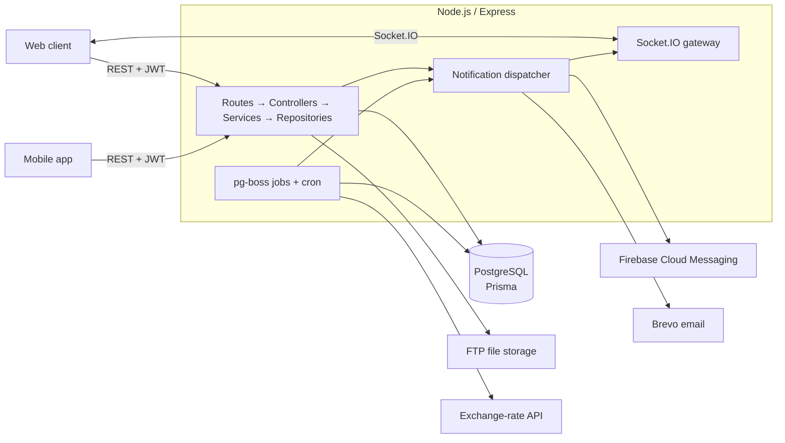

# Pleingaz ERP — Backend API

> Production backend for an ERP system used by a gas distribution company in Cameroon: HR & access control, supplier management, purchasing workflows with multi-step approvals, payments, invoicing, and real-time notifications.

[](https://github.com/SMXKY/pleingaz-infotech-api/actions/workflows/ci.yml)


## At a glance

| | |
|---|---|
| **Role** | Sole backend developer — design, data modelling, implementation, API documentation, QA fixes |
| **Scope** | 35 REST resources under `/api/v1`, 43 database models, ~38k lines of TypeScript |
| **Users** | Web and mobile clients for staff from accounting, operations, and management |
| **Languages** | Every API message is available in French and English (`x-lang` header) |
| **Timeline** | Feb 2026 – Mar 2026 |

## The problem

The company was running purchasing on email and spreadsheets: gas, gas-bottle, and accessory orders
sent to suppliers, approved informally, and paid with little traceability. This API replaces that with a
single system of record that enforces who may do what, records every change, and makes each order
go through the same approval and payment lifecycle.

## Highlights

**Fine-grained RBAC with permission implication.** Permissions are modelled as
`module × submodule × action` with a risk level. Roles get permission sets, individual users can have
per-user overrides, and granting a permission can imply its prerequisites
(e.g. `update` implies `read`). Routes declare required permissions through a `restrictTo(...)` middleware.

**Approval workflow engine.** Creating a purchase order starts a two-step approval chain
(Accounting → CEO). Each decision notifies the next approver; final approval unlocks payment.
The same engine serves all three order types.

**Payments → invoices → supplier metrics.** Recording a payment creates the invoice if needed,
moves the order and invoice between `PARTIAL` / `PAID` / `FINALIZED`, and recalculates supplier
performance metrics (delivery, cancellation, spend) automatically.

**Multi-channel notifications with fallback.** A dispatcher delivers each notification over
Socket.IO if the user is online, otherwise via Firebase Cloud Messaging push. Urgent notifications
still unread after a configurable delay are escalated to email. Background jobs (pg-boss) handle
escalation, expiry, and cleanup of stale device tokens.

**Multi-currency.** Orders can be priced in XAF, USD, or EUR; totals are converted to XAF using
exchange rates refreshed by a scheduled job, and a conversion endpoint is exposed for clients.
Decimal and BigInt values are serialised as strings to avoid precision loss.

**Audit trail.** A generic `BaseService` wraps create/update/delete in a transaction and writes an
activity log entry with the previous and new state of the record, the user, and request metadata.

## Architecture



Each feature module in `src/modules/<name>/` follows the same layered layout:

```
<name>.route.ts       # Express router, auth + permission middleware
<name>.controller.ts  # HTTP in/out, extends BaseController
<name>.service.ts     # Business rules, Zod validation, hooks (beforeCreate/afterUpdate…)
<name>.repository.ts  # Prisma data access, extends BaseRepository
<name>.schema.ts      # Zod request schemas
```

Shared base classes (`src/base/`) give every module pagination, filtering, sorting, relation
includes, soft delete/restore, validation, and audit logging, so a new resource is mostly a schema and
any business rules it needs.

## Tech stack

| Concern | Choice |
|---|---|
| Runtime / framework | Node.js, Express 5, TypeScript (strict) |
| Database | PostgreSQL, Prisma ORM, 30+ versioned migrations |
| Validation | Zod |
| Auth | JWT, Argon2 password hashing, login-attempt lockout, password-reset tokens |
| Real-time | Socket.IO |
| Background work | pg-boss (Postgres-backed queue), node-cron |
| Notifications | Firebase Admin (FCM), Brevo transactional email |
| Docs | OpenAPI 3 + Swagger UI |
| i18n | JSON locale files (FR/EN), resolved per request |

## Getting started

**Prerequisites:** Node.js 20+, PostgreSQL 14+

```bash
git clone https://github.com/SMXKY/pleingaz-infotech-api.git
cd pleingaz-infotech-api
npm install                 # also runs `prisma generate`
cp .env.example .env        # then fill in values
npx prisma migrate deploy   # create the schema
npm run dev                 # http://localhost:3000
```

On first boot the server seeds default departments, roles, permissions, finance settings, and a
super-admin account from the `SUPER_ADMIN_*` variables.

Third-party integrations (Firebase, Brevo, FTP, exchange-rate API) need their own credentials;
see `.env.example`. Set `CORS_ORIGINS` to a comma-separated list of allowed origins; if it is
unset, all origins are allowed.

| Script | What it does |
|---|---|
| `npm run dev` | Start with hot reload |
| `npm test` | Run the Jest test suite |
| `npm run lint` | ESLint |
| `npm run typecheck` | TypeScript type-check of `src` and `tests` |
| `npm run build` / `npm start` | Production build and run |

## Testing

Tests live in `tests/` and run without a database: a lightweight Prisma mock
(`tests/helpers/prismaMock.ts`) stands in for the client, and `$transaction` runs against it.

- **Approval workflow:** role checks per step, advancing steps, final approval, rejection cancelling the order
- **Order totals:** VAT, regulatory tax, shipping/freight/customs, and currency conversion with Decimal precision
- **Error mapping:** Prisma and JWT errors to HTTP status codes
- **Permissions:** the `restrictTo` middleware
- **HTTP:** health check, OpenAPI spec, 404 handler, and JWT rejection, via Supertest

GitHub Actions runs lint, type-check, tests, and the production build on every push and pull request.

## API documentation

Interactive Swagger UI is served at **`/docs`**, and the raw OpenAPI spec at **`/docs.json`**.
The docs include an integration-order guide for frontend and mobile developers, the full order
lifecycle, push-notification setup, and the Socket.IO event contract.

| Header | Purpose |
|---|---|
| `Authorization: Bearer <token>` | Required on protected routes; obtain via `POST /api/v1/users/auth/login` |
| `x-lang: FR \| ENG` | Response message language (default FR) |

## Project structure

```
prisma/              schema.prisma + migrations
src/
  base/              BaseController / BaseService / BaseRepository
  modules/           one folder per resource (users, roles, suppliers, gasPurchaseOrder, approval, payments…)
  middlewares/       auth (protect), permissions (restrictTo), language, file uploads
  services/          FCM, notification dispatcher, FTP
  jobs/              pg-boss queue and scheduled notification jobs
  cron-jobs/         exchange-rate updates
  socket/            Socket.IO server and presence tracking
  defaults/          seed data (roles, permissions, departments…)
  locales/           en.json / fr.json
  docs/              OpenAPI definitions
  public/templates/  HTML email and purchase-order templates
```

## What I'd do next

- Extend tests to the payment and invoicing flow, and add integration tests against a real PostgreSQL in CI.
- Lock the order row (`SELECT … FOR UPDATE`) when recording payments so concurrent requests can't double-count.
- Consolidate the two Prisma client instances into a single shared module.
- Move file storage from FTP to S3-compatible object storage.
- Add structured logging and request tracing in place of `console.log`.

## License

Source code shared for portfolio purposes. All rights reserved.
